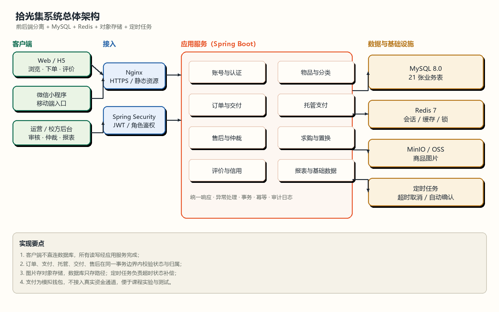
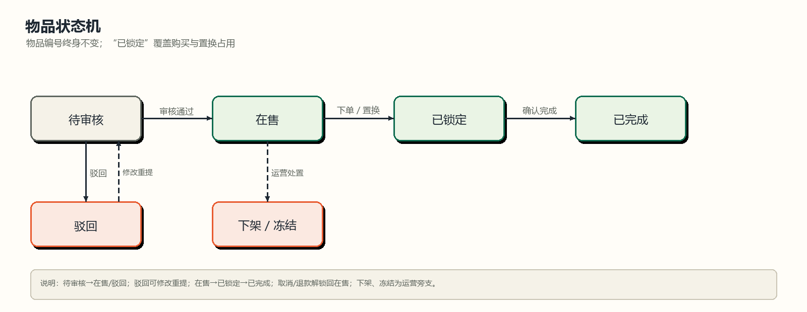
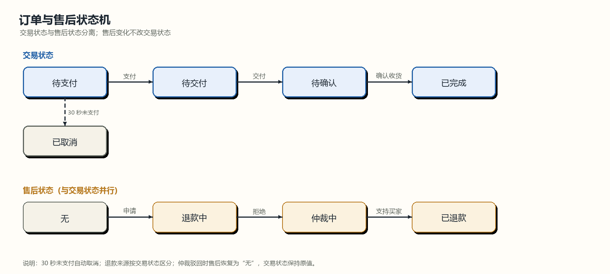
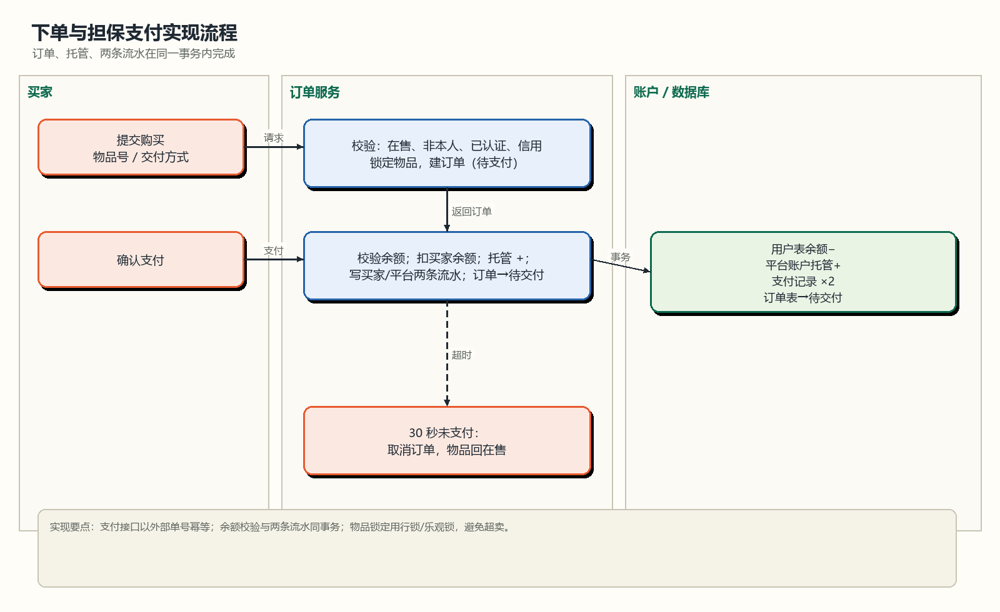
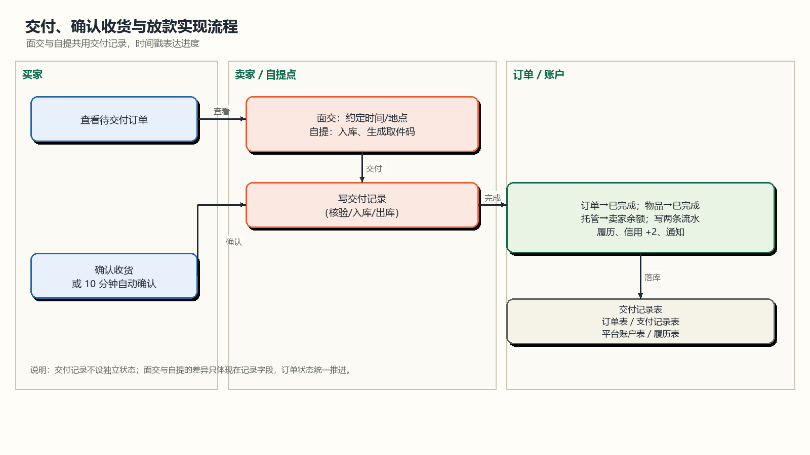
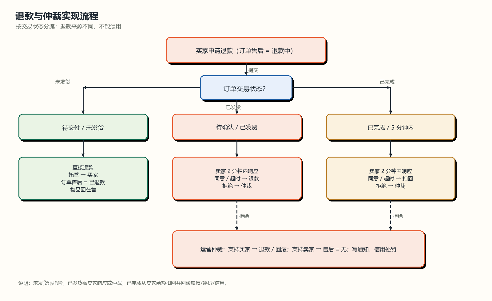
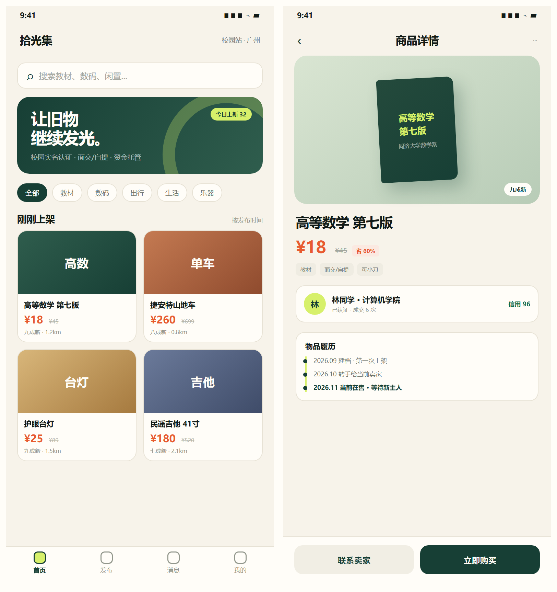
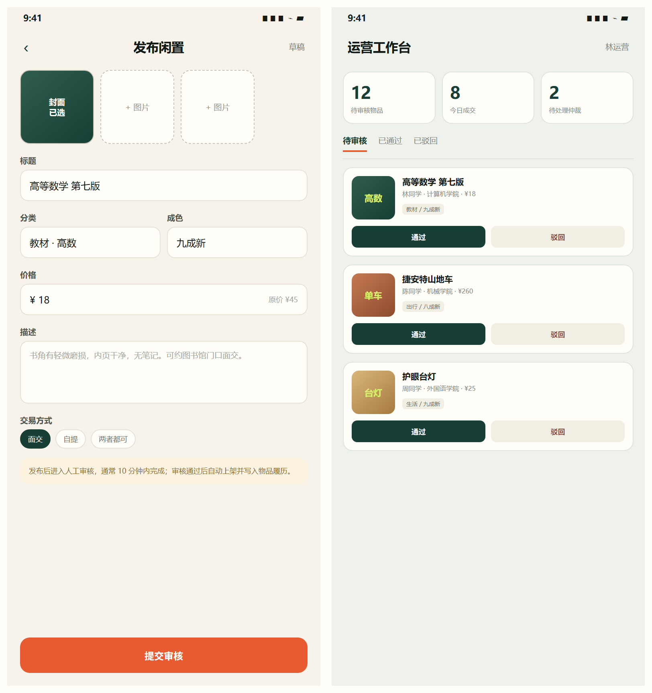
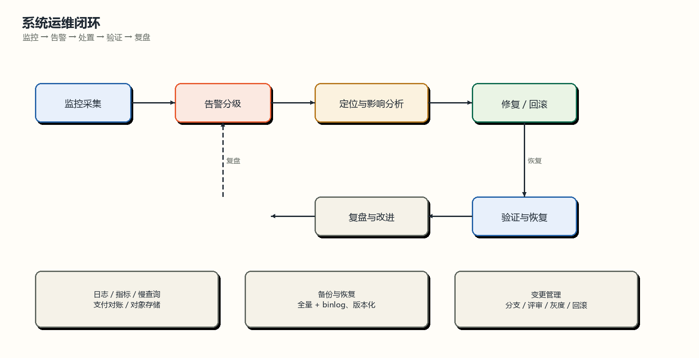

# 第5章 系统实现

本项目在前四章完成了可行性研究、需求分析、总体设计和详细设计，形成了 14 条业务流程（F1—F14）和 21 张数据表的完整设计。受课程周期和团队规模限制，本项目当前完成的是关键模块的原型实现与实现方案设计，尚未完成全部业务代码。本章从开发环境、总体架构、数据库连接、关键模块、界面原型和测试方案六个方面说明“怎样把设计变成可运行系统”，为后续编码迭代提供可直接执行的依据。

## 5.1 开发平台与开发环境

### 5.1.1 技术选型

系统采用前后端分离的 B/S 架构。前端面向学生提供 Web/H5 页面，面向运营和校方提供后台页面；后端采用 Spring Boot 提供 REST 接口；MySQL 保存 21 张业务表；Redis 承担会话、热点缓存和分布式锁；MinIO 或对象存储保存商品图片。选择单体模块化而不是微服务，是因为校园二手平台的用户规模和并发量有限，单体应用更容易保证订单、支付、托管、售后之间的事务一致性，也便于课程团队协作和部署。

表 5-1 系统技术选型

| 类别 | 选型 | 版本 | 用途 |
|---|---|---|---|
| 开发语言 | Java | 17 | 后端业务实现 |
| 后端框架 | Spring Boot / Spring Security | 3.2 / 6 | REST 接口、鉴权、事务 |
| 数据访问 | MyBatis-Plus | 3.5 | SQL 映射、分页、乐观锁 |
| 数据库 | MySQL | 8.0 | 21 张业务表、事务与约束 |
| 缓存 | Redis | 7 | 会话、热点数据、分布式锁 |
| 对象存储 | MinIO / 阿里云 OSS | 最新稳定版 | 商品图片 |
| 前端框架 | Vue 3 / Vite | 3.4 / 5 | Web 与后台页面 |
| UI 组件 | Element Plus / Vant | 最新稳定版 | PC 后台、移动端组件 |
| 接口文档 | SpringDoc OpenAPI | 3 | Swagger UI 与接口契约 |
| 构建工具 | Maven / pnpm | 3.9 / 9 | 依赖管理与前端构建 |
| 测试工具 | JUnit 5 / Mockito / Postman | 最新稳定版 | 单元、接口与集成测试 |
| 部署 | Nginx / Docker Compose | 最新稳定版 | 反向代理、容器编排 |

### 5.1.2 开发与运行环境

表 5-2 开发与运行环境

| 环境 | 配置 | 说明 |
|---|---|---|
| 开发系统 | Windows 11 / Ubuntu 22.04 | 团队成员本机 |
| JDK | OpenJDK 17 | 后端编译与运行 |
| Node.js | 20 LTS | 前端构建 |
| 数据库 | MySQL 8.0，字符集 utf8mb4 | 本地开发与测试 |
| 缓存 | Redis 7 | 本地 Docker 启动 |
| 对象存储 | MinIO 本地服务 | 开发阶段替代 OSS |
| 运行方式 | Nginx + Spring Boot + MySQL + Redis | 单机或云服务器 |
| 浏览器 | Chrome / Edge 最近两个大版本 | 前端与后台调试 |

### 5.1.3 工程结构

工程按“前端、后端、数据库、文档、部署”划分，后端再按领域模块拆分。这样既能保持单体应用的事务边界，又能让不同成员按模块并行开发。

```text
shiguangji/
├─ frontend/                 # Vue 3 前端
│  ├─ src/views/             # 首页、详情、发布、订单、后台
│  ├─ src/api/               # 接口封装
│  ├─ src/stores/            # Pinia 状态
│  └─ src/router/            # 路由与权限
├─ backend/                  # Spring Boot 后端
│  ├─ src/main/java/.../auth/        # 注册、登录、学籍认证
│  ├─ src/main/java/.../item/        # 物品、分类、图片、审核
│  ├─ src/main/java/.../order/       # 订单、交付、售后
│  ├─ src/main/java/.../payment/     # 钱包、托管、流水
│  ├─ src/main/java/.../swap/        # 求购、悬赏、置换
│  ├─ src/main/java/.../credit/      # 评价、信用、通知
│  ├─ src/main/java/.../report/      # 运营报表、基础数据
│  └─ src/main/resources/            # 配置、Mapper XML
├─ database/
│  ├─ schema.sql             # 21 张表建表脚本
│  └─ data.sql               # 学籍、分类、自提点初始数据
├─ docs/                     # 报告、接口文档、图表
└─ docker-compose.yml        # MySQL、Redis、MinIO、后端
```

### 5.1.4 本阶段的实现边界

本阶段已经完成：业务流程梳理、21 张表的结构与约束设计、核心接口契约、关键状态机、支付与托管的事务方案、界面原型和测试方案。尚未完成：全部 Controller/Service/Mapper 代码、真实支付通道、真实文件上传、并发压测和线上部署。第 5 章中的“实现”均指可落地的实现方案与原型，不把原型图写成运行截图。

## 5.2 系统总体实现架构

系统总体架构如图 5-1 所示。客户端包括 Web/H5、微信小程序和运营/校方后台；请求经 Nginx 进入 Spring Security 鉴权，再进入 Spring Boot 应用服务；应用服务按账号认证、物品分类、订单交付、托管支付、售后仲裁、求购置换、评价信用、报表基础数据八个模块组织；MySQL、Redis、MinIO 和定时任务构成数据与基础设施层。



### 5.2.1 分层职责

表 5-3 系统分层与职责

| 层次 | 主要职责 | 不做什么 |
|---|---|---|
| 客户端 | 页面展示、表单校验、调用接口、展示状态 | 不直连数据库，不保存他人敏感信息 |
| 接入层 | HTTPS、静态资源、反向代理、限流 | 不承载业务状态 |
| 应用服务 | 鉴权、业务校验、事务、状态推进、幂等 | 不把状态判断散落在 Controller |
| 数据层 | 持久化、约束、索引、事务隔离 | 不承担业务规则 |
| 定时任务 | 超时取消、自动确认、评价窗口、对账 | 不重复执行已完成的业务 |
| 对象存储 | 保存商品图片，数据库只存路径 | 不保存业务记录 |

### 5.2.2 统一请求处理链

一次写请求按“参数校验 → 登录与角色校验 → 业务归属校验 → 状态校验 → 事务写入 → 返回统一响应”的顺序执行。Controller 只负责接收参数和返回结果；Service 负责业务规则和事务；Mapper 只负责 SQL。订单、支付、售后等跨表操作必须在 Service 的事务方法内完成，禁止在 Controller 中逐表调用。

统一响应采用 `code`、`message`、`data` 三个字段；业务异常使用统一异常处理器转换为可读提示；分页统一使用 `page`、`size`、`total`、`records`。所有写接口要求携带登录令牌，后台接口额外校验角色。关键写操作记录操作人、时间、请求号和结果，便于追查。

### 5.2.3 权限与角色

表 5-4 角色与权限边界

| 角色 | 可以做什么 | 不可以做什么 |
|---|---|---|
| 学生 | 注册登录、学籍认证、发布物品、下单、支付、评价、申请售后、求购、置换 | 不能审核自己的物品，不能修改他人订单，不能直接改余额 |
| 运营 | 审核物品、处理仲裁、查看报表、处罚违规 | 不修改学籍库、分类和自提点等基础数据 |
| 校方管理员 | 导入学籍、维护分类、维护自提点、创建运营账号 | 不参与物品审核、仲裁和交易处置 |

角色权限落在服务端，不依赖前端隐藏按钮。学生只能操作“当前持有人=自己”的物品和“买家/卖家=自己”的订单；后台接口按角色注解拦截；越权请求返回 403，并写入审计日志。

## 5.3 数据库连接与数据访问实现

### 5.3.1 连接配置

后端通过环境变量注入数据库连接信息，不在代码仓库中保存真实密码。开发环境连接本地 MySQL，生产环境连接云数据库；连接池使用 HikariCP，开启事务、批处理和慢 SQL 日志。

```yaml
spring:
  datasource:
    url: ${DB_URL:jdbc:mysql://127.0.0.1:3306/shiguangji?useUnicode=true&characterEncoding=utf8&serverTimezone=Asia/Shanghai}
    username: ${DB_USER:shiguang}
    password: ${DB_PASSWORD:change-me}
    driver-class-name: com.mysql.cj.jdbc.Driver
    hikari:
      maximum-pool-size: 20
      minimum-idle: 5
      connection-timeout: 3000
      idle-timeout: 600000
      max-lifetime: 1800000
  transaction:
    default-timeout: 10
```

### 5.3.2 事务与数据访问

订单支付、交付放款、退款回滚都涉及多张表，使用 `@Transactional` 保证同一事务内的写入要么全部成功，要么全部回滚。涉及物品锁定、余额扣减等并发写操作时，先对目标行加锁或使用版本号，再校验状态，避免“两个买家同时买到同一件物品”。

```java
@Transactional(rollbackFor = Exception.class)
public void pay(Long orderId, Long buyerId, String externalNo) {
    Order order = orderMapper.selectForUpdate(orderId);
    if (!order.getBuyerId().equals(buyerId)) throw new BizException("无权支付");
    if (!"待支付".equals(order.getTradeStatus())) throw new BizException("订单状态不允许支付");
    if (paymentMapper.existsExternalNo(externalNo)) return; // 幂等

    User buyer = userMapper.selectForUpdate(buyerId);
    if (buyer.getBalance().compareTo(order.getAmount()) < 0) throw new BizException("余额不足");

    userMapper.decreaseBalance(buyerId, order.getAmount());
    platformMapper.increaseEscrow(order.getAmount());
    paymentMapper.insertUserPayment(order, buyerId, "支付", order.getAmount());
    paymentMapper.insertPlatformPayment(order, "支付", order.getAmount());
    orderMapper.updateTradeStatus(orderId, "待交付");
}
```

### 5.3.3 核心表与模块对应

表 5-5 核心表与业务模块对应

| 模块 | 主要表 | 关键约束 |
|---|---|---|
| 注册认证 | 用户表、学籍表、认证记录表、通知表 | 用户名唯一、学号唯一、认证记录只增不改 |
| 物品发布 | 物品表、分类表、物品图片表、履历记录表、审核记录表 | 每件物品仅一张有效首图；分类最多两级 |
| 订单支付 | 订单表、支付记录表、平台账户表、用户表 | 外部单号唯一；订单+类型+账户标识唯一 |
| 交付完成 | 订单表、交付记录表、自提点表、履历记录表、信用记录表 | 取件码唯一；交付记录只记时间戳 |
| 售后仲裁 | 订单表、支付记录表、平台账户表、评价表、信用记录表、仲裁申请表 | 一单一评；信用记录防重复 |
| 求购置换 | 悬赏单表、置换意向表、置换方案表、订单表 | 同一物品仅一条有效意向；方案 10 分钟内确认 |

数据库中的外键、唯一约束和生成列不是“可选项”，而是业务一致性的最后一道防线。例如，支付记录用 `(订单号, 类型, 账户标识)` 唯一约束防止重复记账；物品图片用“物品编号 + 有效首图”生成列保证每件物品只有一张首图；评价用 `(订单号, 评价人)` 保证一单一评。应用层校验负责给出友好提示，数据库约束负责兜底。

## 5.4 关键模块实现

物品状态机和订单/售后状态机分别如图 5-2、图 5-3 所示。物品状态决定“能不能卖”，订单状态决定“交易走到哪一步”，售后状态单独记录退款/仲裁，不与交易状态混用。





### 5.4.1 注册、登录与学籍认证

注册时校验用户名全局唯一，密码使用 BCrypt 哈希保存，账号初始角色为学生、认证状态为未认证。登录校验用户名和密码哈希，成功后签发 JWT；未认证或认证被驳回的用户只能浏览，不能发布、下单、求购或置换。

学籍认证读取学籍表中的学号、姓名、学院、专业、年级进行比对；每次提交生成一条认证记录，不覆盖历史。认证通过后在一个事务内更新用户表的认证状态和学号、写认证记录、写通知；认证驳回则写认证记录和通知，用户可修改后重新提交。一个学号只能绑定一个账号，数据库唯一约束兜底。

```text
F2 学籍认证：
读取用户提交的学号、姓名、学院
→ 查询学籍表比对
→ 通过：写认证记录（通过、时间）
        写用户表（已认证、绑定学号）
        写通知表（认证结果）
→ 驳回：写认证记录（驳回、原因）
        写用户表（驳回）
        写通知表（认证结果）
```

### 5.4.2 物品发布、图片与审核

发布前校验用户已认证、分类存在且为二级分类、图片数量与格式合法。提交后生成物品编号，写物品表（待审核），写物品图片表（有效图、首图唯一），并写通知或待办给运营。审核由运营在后台完成：通过时写物品表（在售、上架时间）、写履历记录表首条“建档”、写审核记录和通知；驳回时写物品表（驳回）、写审核记录和通知。F3 只承接审核结果，不重复写审核记录。

图片不存数据库 BLOB，先上传对象存储，数据库只保存路径、排序、首图标记和状态。再次上架（F10）时，旧图状态改为“历史”而不是删除，保证履历和图片可追溯；新图标记有效，首图仍保持唯一。

### 5.4.3 浏览、搜索与详情

首页和搜索页只查询状态为“在售”的物品，支持分类、关键词、价格区间、成色和排序；列表只取有效图片中的首图作为缩略图。详情页读物品表、有效图片、履历记录、卖家认证与信用信息；评价不在详情页展示，避免把“展示”与“信用”混在一起。

数据量在校园范围内有限，搜索先用 MySQL 的 `LIKE`/全文索引和复合索引满足；当物品量增长到十万级再考虑 Elasticsearch。物品详情可以使用 Redis 缓存，但物品状态变化（锁定、完成、下架）必须主动失效缓存，避免用户看到“在售”却无法下单。

### 5.4.4 下单与担保支付

买家在详情页点击“立即购买”后，系统校验物品在售、当前持有人不是买家、买家已认证且信用正常；选择面交或自提（自提需选自提点）。校验通过后，在一个事务内写订单（待支付）、把物品置为“已锁定”。订单 30 秒未支付由定时任务取消，物品回到在售。

支付时再次校验订单状态和余额，扣买家余额、增加平台托管、写两条支付记录（账户类型=用户/平台），订单转为“待交付”。支付接口以外部单号做幂等，重复回调不会重复扣款。实现流程如图 5-4 所示。



表 5-6 订单与物品状态对应

| 阶段 | 订单交易状态 | 物品状态 | 资金状态 |
|---|---|---|---|
| 下单未支付 | 待支付 | 已锁定 | 未扣款 |
| 支付成功 | 待交付 | 已锁定 | 平台托管 |
| 交付完成 | 待确认 | 已锁定 | 平台托管 |
| 确认收货 | 已完成 | 已完成 | 卖家余额 |
| 30 秒未支付 | 已取消 | 在售 | 无流水 |
| 未发货退款 | 原状态 | 在售 | 托管退回买家 |

### 5.4.5 交付、确认与放款

交付只支持面交和自提，不接快递。面交写约定时间、地点和核验时间；自提写入库时间、取件码、自提点号和出库时间。交付记录不设独立状态，用时间戳表达进度，避免与订单状态重复。

买家确认收货后，订单转“已完成”、物品转“已完成”；系统在一个事务内把托管转给卖家、写平台和卖家两条支付记录、写履历“成交”、双方信用 +2、写通知。买家 10 分钟未确认时由定时任务自动确认；自动确认与手动确认使用同一段幂等逻辑，重复执行不会重复放款。实现流程如图 5-5 所示。



### 5.4.6 退款与仲裁

退款按交易状态分流：待交付/未发货直接退托管；待确认/已发货需要卖家在 2 分钟内响应，同意或超时退款，拒绝转仲裁；已完成/收货后 5 分钟内申请售后的，从卖家余额扣回并回滚履历、评价和信用，拒绝同样转仲裁。

退款来源不能混用：未发货退的是平台托管，已完成退的是卖家余额；两条路径都要写对应的支付流水，不能只改余额不记账。仲裁由运营读取订单、支付、交付、履历、评价等证据，支持买家则执行退款/回滚，支持卖家则把售后状态恢复为“无”，交易状态保持原值。实现流程如图 5-6 所示。



### 5.4.7 求购悬赏与三方置换

求购先按分类、关键词、预算和成色匹配在售物品；有匹配直接返回列表，无匹配写悬赏单（悬赏中）。卖家发布物品后，系统按分类、关键词和价格容差（默认 ±20%）匹配悬赏单，命中写通知。悬赏成交由 F6 在订单完成时写“已成交”，到期或关闭写“已过期/已关闭”；同一买家最多 3 条“悬赏中”。

三方置换用有向图表示“我的物品 → 期望物品/条件”，寻找二人互换或三人环。匹配时校验物品状态、持有人、信用和意向有效期；命中后锁定物品、写置换方案（待确认、10 分钟截止）、通知三方。三方全部确认后写 3 张置换单（金额 0、面交、待交付），线下面交后完成订单、变更归属、写履历；任一拒绝或超时则方案作废、物品解锁。

```text
构建有向边：意向(我的物品 → 期望物品/条件)
for 每个有效意向 A:
    找 A 的期望物品当前持有人 B
    若 B 的意向指向 A 的物品：二人环
    若 B 的意向指向 C，且 C 的意向指向 A 的物品：三人环
校验：物品在售、持有人匹配、信用正常、意向有效
→ 锁定物品、写方案、通知三方、10 分钟内确认
```

### 5.4.8 评价、信用与通知

评价以 `(订单号, 评价人)` 唯一，一单一评，提交后不可修改。订单完成后开启 10 分钟评价窗口；双方评完或窗口结束展示评价；超时未评价由定时任务写“系统默认”，不计分；退款成立时评价作废。评价只影响展示，不改变履历和信用。

信用记录与评价分离：完成交易双方 +2，爽约、描述不符、违禁、恶意申请等由运营扣分；信用记录表保存“怎么变过来的”，用户表保存当前信用分。通知只发“结果/行动”类：认证结果、审核结果、悬赏命中、置换邀请、售后结果、仲裁受理、仲裁结果、订单完成；订单进行中的状态变化在“我的订单”里看，不重复发通知。

### 5.4.9 运营报表与校方管理

运营报表实时计算、不落报表表：按时间范围与维度读取订单表统计成交量和成交额，按账户类型=用户读取支付记录统计退款/扣回，按物品分类统计成交分布，按履历统计流转次数，按悬赏单和置换方案统计成功率，按审核记录和仲裁申请统计处理量。学院维度通过用户表学号关联学籍表，运营/管理员账号无学号，统计时排除。

校方管理员负责导入/更新学籍、维护分类（最多两级）和自提点、创建运营账号；被物品引用的分类不能删除，被订单或交付记录引用的自提点不能删除。管理员不参与审核、仲裁和交易，角色分权避免“既当运动员又当裁判”。

### 5.4.10 定时任务与状态补偿

表 5-7 定时任务与超时规则

| 任务 | 触发条件 | 处理 | 幂等要求 |
|---|---|---|---|
| 取消未支付订单 | 创建后 30 秒 | 订单→已取消、物品→在售 | 只处理待支付订单 |
| 自动确认收货 | 交付后 10 分钟 | 订单→已完成、放款、履历、信用 | 已完成订单直接返回 |
| 评价窗口结束 | 完成后 10 分钟 | 未评价方写系统默认 | 已有评价不重复写 |
| 售后申请窗口 | 收货后 5 分钟 | 关闭售后入口 | 以完成时间为准 |
| 卖家售后响应 | 申请后 2 分钟 | 超时视为同意 | 已处理申请跳过 |
| 置换方案确认 | 生成后 10 分钟 | 未全部确认→作废、解锁 | 已生效/已作废跳过 |
| 平台托管对账 | 每日 | 托管余额=流入−流出 | 只读校验，不直接改账 |

定时任务使用分布式锁或 `SELECT ... FOR UPDATE SKIP LOCKED` 领取待处理记录，处理前再次校验状态，处理完成后写幂等标记。任务失败进入重试队列，超过重试次数告警，不静默丢失。

## 5.5 界面原型

本阶段没有可运行的前端代码，以下为按移动端尺寸绘制的界面原型，用于确认信息层级、字段和交互，不作为运行截图。买家端首页和商品详情如图 5-7 所示；发布页和运营审核后台如图 5-8 所示。



首页把“搜索、分类、刚刚上架”放在首屏，物品卡片展示首图、标题、价格、原价、成色和距离；详情页突出价格、成色、卖家认证与信用、物品履历和“立即购买”。物品履历是平台区别于普通二手群的核心信息，因此在详情页单独成块展示。



发布页要求封面、标题、分类、成色、价格、描述和交易方式；提交后进入人工审核，页面明确提示“审核通过后自动上架并写入履历”。审核后台以待审核列表为主，展示物品、卖家、价格、分类和成色，提供“通过/驳回”两个动作，避免运营在列表页做过多编辑。

## 5.6 测试

### 5.6.1 测试目标与策略

测试目标是验证 14 条业务流程的状态、权限、金额和约束是否一致，重点覆盖：注册认证、发布审核、下单支付、交付放款、退款仲裁、求购置换、评价信用和定时任务。测试采用“单元测试—接口集成测试—原型走查—验收测试”的分层策略；单元测试用 JUnit 5 + Mockito，接口测试用 Postman/Apifox，数据库测试使用独立测试库并在每个用例后回滚。

本阶段没有完整代码，因此测试分为两部分：已完成的静态检查与原型走查；待编码阶段执行的单元、接口和并发测试。报告不把“待执行”写成“已通过”。

### 5.6.2 测试环境

表 5-8 测试环境

| 项目 | 配置 |
|---|---|
| 操作系统 | Windows 11 / Ubuntu 22.04 |
| JDK | OpenJDK 17 |
| 数据库 | MySQL 8.0，独立测试库 |
| 缓存 | Redis 7，独立 DB |
| 接口工具 | Postman / Apifox |
| 单元测试 | JUnit 5 + Mockito |
| 前端 | Chrome / Edge 最近两个大版本 |
| 测试数据 | 学籍、分类、自提点、用户、物品、订单初始化脚本 |

### 5.6.3 单元测试设计

表 5-9 单元测试用例（节选）

| 编号 | 被测模块 | 输入/场景 | 预期结果 |
|---|---|---|---|
| UT-01 | 注册 | 用户名已存在 | 返回“用户名已存在”，不写用户表 |
| UT-02 | 学籍认证 | 学号已绑定其他账号 | 驳回，写认证记录，不覆盖旧账号 |
| UT-03 | 发布 | 未认证用户发布 | 拒绝，提示先认证 |
| UT-04 | 发布 | 上传两张首图 | 只允许一张有效首图 |
| UT-05 | 下单 | 物品已锁定 | 拒绝下单，提示不可购买 |
| UT-06 | 下单 | 买家=当前持有人 | 拒绝，提示不能购买自己的物品 |
| UT-07 | 支付 | 余额不足 | 拒绝支付，订单仍待支付 |
| UT-08 | 支付 | 同一外部单号重复回调 | 只扣款一次，返回成功 |
| UT-09 | 支付 | 正常支付 | 买家余额−、托管+、两条流水、订单待交付 |
| UT-10 | 交付 | 面交/自提分别写记录 | 时间戳、取件码字段正确 |
| UT-11 | 放款 | 重复确认收货 | 只放款一次，信用只加一次 |
| UT-12 | 退款 | 未发货退款 | 托管退回买家，物品回在售 |
| UT-13 | 退款 | 已完成售后 | 卖家余额扣回，履历/评价/信用回滚 |
| UT-14 | 评价 | 同一订单同一评价人重复提交 | 唯一约束拒绝 |
| UT-15 | 置换 | 三人环缺一人确认 | 10 分钟后方案作废、物品解锁 |

### 5.6.4 接口集成测试

表 5-10 接口集成测试用例（节选）

| 编号 | 场景 | 关键校验 |
|---|---|---|
| IT-01 | 注册→登录→认证→发布→审核→上架 | 认证前不能发布；审核通过后物品在售 |
| IT-02 | 浏览→详情→下单→支付→交付→确认→评价 | 订单、物品、资金、履历、信用五条线一致 |
| IT-03 | 下单后 30 秒未支付 | 订单取消、物品回在售、无支付流水 |
| IT-04 | 支付失败/余额不足 | 订单仍待支付，物品仍锁定，可重试 |
| IT-05 | 未发货退款 | 托管退回，订单售后已退款，物品在售 |
| IT-06 | 已发货退款卖家拒绝→仲裁支持买家 | 退款、回滚、通知、信用处罚 |
| IT-07 | 已完成售后成立 | 卖家余额扣回，履历退货、评价作废、信用回滚 |
| IT-08 | 悬赏发布→卖家上架命中→下单 | 通知买家，订单来源悬赏号正确 |
| IT-09 | 三人置换全部确认 | 方案生效，3 张置换单，物品归属变更 |
| IT-10 | 越权修改他人物品 | 返回 403，数据不变，写审计日志 |

### 5.6.5 验收测试与原型走查

验收测试按 14 条业务流程逐条走查：每条流程从触发、正常路径、异常路径、权限边界和结果五方面检查。本阶段已完成界面原型的走查，确认首页、详情、发布、审核四个关键页面的信息层级和操作入口；状态机、支付、退款、置换的流程与数据表对照检查已完成；代码级验收待实现后执行。

### 5.6.6 测试结论

本阶段完成的检查包括：21 张表的主外键与唯一约束静态核对、14 条业务流程与表读写对照、界面原型走查、状态机与定时任务规则核对。未执行的部分包括：真实接口单元测试、并发下单/重复支付测试、MySQL 事务隔离测试、文件上传与对象存储测试、性能和安全的压力测试。结论是：设计与原型层面具备可实施性，代码实现后必须按表 5-9、表 5-10 补齐测试，不能以原型走查代替功能测试。

# 第6章 维护

## 6.1 系统维护过程

系统上线后进入运行维护阶段。维护不只是“修 bug”，还包括适应学校规则变化、完善功能和预防故障。本项目把维护分为改正性、适应性、完善性和预防性四类，统一走“问题登记—影响分析—分支修改—测试—评审—发布—观察—复盘”的流程，避免直接改线上数据或绕过测试。



表 6-1 维护类型与触发条件

| 类型 | 触发 | 典型工作 |
|---|---|---|
| 改正性维护 | 用户反馈、监控告警、对账不平 | 修复状态错误、金额差错、接口异常 |
| 适应性维护 | 学校规则、分类、自提点、浏览器/微信版本变化 | 调整配置、兼容新环境、更新基础数据 |
| 完善性维护 | 用户提出新需求、运营需要新报表 | 增加筛选、导出、通知、统计维度 |
| 预防性维护 | 容量接近阈值、依赖漏洞、备份演练 | 加索引、升级依赖、扩容、演练恢复 |

### 6.1.1 变更管理

所有变更先建 issue，写清楚背景、影响范围、回滚方案和验证步骤；从主分支拉出功能分支，提交代码和测试；至少一名成员评审；合并后在测试环境跑回归；发布采用灰度或低峰期发布；发布后观察日志、错误率和关键业务指标，确认无误再关闭 issue。数据库变更使用 Flyway 管理版本，禁止手工改生产表结构。

### 6.1.2 监控与告警

表 6-2 监控指标与阈值（建议）

| 指标 | 采集方式 | 告警阈值 | 处理 |
|---|---|---|---|
| 接口错误率 | 网关/应用日志 | 5 分钟 > 1% | 查看异常堆栈，必要时回滚 |
| 接口 P95 延迟 | APM/日志 | > 800ms 持续 5 分钟 | 查慢 SQL、缓存、线程池 |
| MySQL 连接数 | 数据库监控 | > 80% 最大连接 | 查连接泄漏、扩容 |
| 慢查询 | 慢日志 | > 1s | 加索引、改写 SQL |
| 托管余额对账差 | 每日对账任务 | 差额 ≠ 0 | 冻结相关订单，人工核查 |
| 定时任务失败 | 任务日志 | 连续 2 次失败 | 重试、告警、人工补偿 |
| 磁盘/对象存储 | 主机/云监控 | > 80% | 清理历史图、扩容 |
| 登录失败率 | 认证日志 | 短时激增 | 防撞库、限流、封禁 |

### 6.1.3 备份与恢复

表 6-3 备份策略

| 对象 | 频率 | 保留 | 恢复演练 |
|---|---|---|---|
| MySQL 全量 | 每日 02:00 | 30 天 | 每月一次 |
| MySQL binlog | 持续 | 7 天 | 每月一次 |
| 对象存储图片 | 实时/版本化 | 90 天 | 每季度抽查 |
| 配置文件/密钥 | 变更时 | 版本库 | 每季度检查 |
| 审计/支付流水 | 每日归档 | 按法规 | 每半年抽查 |

备份文件与生产环境分离存放，至少一份异地或不同账号；恢复演练必须实际恢复到临时库并校验行数、金额汇总和关键订单，不能只看“备份成功”日志。

## 6.2 系统维护策略

### 6.2.1 数据一致性维护

平台最敏感的是“物品状态、订单状态、托管余额、支付流水”四条线。每日对账任务校验：平台托管余额 = 累计流入 − 累计流出；用户余额 = 充值 − 支付 + 退款/放款；同一订单同一类型同一账户只有一条流水；已锁定物品必须存在对应未完成订单；已完成订单必须存在放款流水。发现差异先冻结相关订单，输出差异清单，人工核查后走修正流程，不能直接改余额。

### 6.2.2 状态修复与人工补偿

超时任务失败、支付回调丢失、交付记录缺失都可能造成“卡状态”。系统提供运营后台的“状态修复”工具，但只允许在指定条件下操作：待支付超时→取消；已锁定但无有效订单→回在售；待确认超时→自动确认；售后超时→按规则退款/关闭。每次修复记录操作人、原因、前后状态，写入审计日志；禁止直接执行 `UPDATE` 改状态。

### 6.2.3 性能与容量

校园平台日常并发不高，优先保证正确性，不做过度设计。物品列表按 `(状态, 分类, 上架时间)` 建复合索引；订单按 `(买家/卖家, 创建时间)` 建索引；支付记录按 `(订单号, 类型, 账户标识)` 唯一约束；慢查询超过 1 秒必须优化。图片走对象存储和 CDN；详情缓存设置短 TTL，状态变化主动失效。数据量增长后先归档历史订单和履历，再考虑读写分离。

### 6.2.4 安全与隐私

后台按角色最小授权；运营只能看处理所需信息，不能导出完整学籍；日志脱敏手机号、学号、密码、令牌；密钥放环境变量或密钥管理服务，不进仓库；上传文件校验类型、大小和内容，图片做压缩和病毒扫描；定期更新依赖，修复高危漏洞；学生注销时删除或匿名化个人信息，保留必要的交易流水按法规存档。

### 6.2.5 发布与回滚

发布前备份数据库、记录当前版本、准备回滚脚本；先发布到测试环境跑回归，再灰度 10% 用户；观察 30 分钟错误率、支付成功率、订单完成率；异常时回滚应用版本，数据库变更采用向后兼容的迁移（先加列、再双写、后删旧列），避免回滚时数据不兼容。

### 6.2.6 文档与培训

维护文档包括：部署手册、接口文档、数据库字典、状态机说明、故障处理手册、对账手册。每次变更同步更新文档；新成员先读状态机和资金规则，再改代码；运营培训重点讲审核标准、仲裁证据、退款边界和禁止事项，避免“凭感觉”处理。

# 第7章 总结与体会

## 7.1 总结

本项目围绕“校园二手交易”完成了从业务到数据的完整设计：梳理了 14 条业务流程（F1—F14），设计了 21 张数据表及其外键、唯一约束和状态规则，形成了物品履历、资金托管、信用与评价分离三个核心机制；在此基础上完成了系统实现方案、关键状态机、支付/交付/退款流程、界面原型和测试方案。

本阶段的主要成果如表 7-1 所示。

表 7-1 本阶段交付物

| 交付物 | 内容 |
|---|---|
| 业务流程 | F1—F14 的触发、过程、结果、涉及表、关键提示 |
| 数据设计 | 21 张表、40 条外键、12 组唯一约束、建表顺序 |
| 实现方案 | 技术选型、工程结构、分层职责、数据库连接、事务与幂等 |
| 关键流程 | 物品状态、订单/售后状态、支付、交付、退款仲裁 |
| 界面原型 | 首页、详情、发布、审核四个关键页面 |
| 测试方案 | 单元、接口、验收测试用例与执行边界 |
| 维护方案 | 监控、备份、对账、状态修复、安全与发布回滚 |

项目的主要不足也要说明：受课程周期限制，尚未完成全部代码，支付是模拟钱包而非真实资金通道，未做真实并发压测和线上部署；三方置换、仲裁、报表等复杂功能目前是设计与原型，不是已运行功能。下一步应按模块优先级实现：先做注册认证、发布审核、浏览下单、支付交付，再做退款仲裁、求购置换和报表；每完成一个模块，按测试用例补齐单元和接口测试。

## 7.2 体会

这次实验最大的体会是：二手交易平台难的不是“把商品列出来”，而是“让物品、订单、资金、信用四条线在异常情况下仍然对得上”。一开始容易把注意力放在页面和功能数量上，真正设计到支付、退款、仲裁时才发现，状态边界、退款来源、幂等、唯一约束才是决定系统能不能用的东西。

第二个体会是“约束要落到数据库”。用户名唯一、学号唯一、一单一评、支付流水唯一、首图唯一，这些规则如果只写在 Service 里，一旦并发或漏判就会产生脏数据；把它们落到唯一约束和事务里，应用层再给出友好提示，系统才稳。设计表时先画外键和状态，再写字段，比先写页面更省返工。

第三个体会是“范围要收”。本项目设计了 14 条流程、21 张表，功能很完整，但实现量远超课程周期。后期我们把目标调整为“设计完整、关键模块原型可用、测试方案可执行”，而不是假装所有功能都已完成。这种取舍让报告更真实，也让后续编码有清晰的优先级。

最后是团队协作和文档的价值。业务流程说明和数据存储清单让不同成员对“谁在什么情况下写哪张表”有共同语言；状态机、接口契约和测试用例让前后端能并行。软件工程的方法不是额外负担，而是用来减少返工和争论的。

# 第8章 附录

## 8.1 数据表清单

表 8-1 业务表清单（21 张）

| 序号 | 表名 | 主要用途 | 主要写入方 |
|---|---|---|---|
| 1 | 学籍表 | 学校学籍名册，认证比对源 | 校方导入 |
| 2 | 用户表 | 账号、角色、认证、信用、余额 | 注册、认证、运营、系统 |
| 3 | 认证记录表 | 每次学籍认证的申请与结果 | 学生、系统 |
| 4 | 分类表 | 物品分类，最多两级 | 管理员 |
| 5 | 物品表 | 物品信息、状态、当前持有人 | 卖家、运营、系统 |
| 6 | 物品图片表 | 有效图与历史图、首图 | 卖家 |
| 7 | 履历记录表 | 建档、成交、置换、退货、维修 | 系统 |
| 8 | 订单表 | 普通订单与置换单、双状态 | 系统 |
| 9 | 支付记录表 | 用户/平台资金流水 | 系统 |
| 10 | 平台账户表 | 托管池单行账户 | 系统 |
| 11 | 交付记录表 | 面交/自提时间戳 | 系统、自提点 |
| 12 | 自提点表 | 校内自提点与面交点 | 管理员 |
| 13 | 评价表 | 一单一评、系统默认、作废 | 买家、卖家、系统 |
| 14 | 信用记录表 | 信用分变动流水 | 系统、运营 |
| 15 | 悬赏单表 | 求购条件与悬赏状态 | 买家、系统 |
| 16 | 置换意向表 | 我的物品与期望条件 | 学生 |
| 17 | 置换方案表 | 二人/三人环与确认状态 | 系统 |
| 18 | 通知表 | 认证、审核、悬赏、售后等通知 | 系统 |
| 19 | 收藏表 | 用户收藏物品 | 买家 |
| 20 | 审核记录表 | 物品审核留痕 | 运营 |
| 21 | 仲裁申请表 | 仲裁申请与裁定 | 用户、运营 |

## 8.2 核心接口清单

表 8-2 核心 REST 接口（节选）

| 方法 | 路径 | 权限 | 说明 |
|---|---|---|---|
| POST | /api/v1/auth/register | 公开 | 注册 |
| POST | /api/v1/auth/login | 公开 | 登录，返回 JWT |
| POST | /api/v1/auth/verify | 学生 | 提交学籍认证 |
| GET | /api/v1/items | 公开 | 在售物品列表、搜索、筛选 |
| GET | /api/v1/items/{id} | 公开 | 物品详情、履历、卖家信用 |
| POST | /api/v1/items | 已认证学生 | 发布物品（待审核） |
| PUT | /api/v1/items/{id}/relist | 当前持有人 | 再次上架 |
| POST | /api/v1/orders | 已认证学生 | 下单，锁定物品 |
| POST | /api/v1/orders/{id}/pay | 买家 | 模拟钱包支付、托管 |
| POST | /api/v1/orders/{id}/delivery | 卖家/自提点 | 写交付记录 |
| POST | /api/v1/orders/{id}/confirm | 买家 | 确认收货、放款 |
| POST | /api/v1/orders/{id}/refund | 买家 | 申请退款 |
| POST | /api/v1/orders/{id}/refund/respond | 卖家 | 同意/拒绝退款 |
| POST | /api/v1/reviews | 订单双方 | 提交评价 |
| POST | /api/v1/wanted | 已认证学生 | 发布求购/悬赏 |
| POST | /api/v1/swaps | 已认证学生 | 提交置换意向 |
| POST | /api/v1/swaps/{id}/confirm | 方案参与人 | 确认置换方案 |
| GET | /api/v1/admin/items/pending | 运营 | 待审核列表 |
| POST | /api/v1/admin/items/{id}/audit | 运营 | 通过/驳回 |
| POST | /api/v1/admin/arbitrations/{id}/decide | 运营 | 仲裁裁定 |
| GET | /api/v1/admin/reports | 运营 | 运营报表 |
| POST | /api/v1/admin/students/import | 管理员 | 导入学籍 |
| PUT | /api/v1/admin/categories/{id} | 管理员 | 维护分类 |

## 8.3 状态与枚举

表 8-3 核心状态与枚举

| 对象 | 字段 | 取值 |
|---|---|---|
| 用户 | 角色 | 学生 / 运营 / 管理员 |
| 用户 | 认证状态 | 未认证 / 已认证 / 驳回 |
| 用户 | 封禁状态 | 正常 / 封禁 |
| 物品 | 状态 | 待审核 / 在售 / 已锁定 / 已完成 / 驳回 / 下架 / 冻结 |
| 订单 | 交易状态 | 待支付 / 待交付 / 待确认 / 已完成 / 已取消 |
| 订单 | 售后状态 | 无 / 退款中 / 仲裁中 / 已退款 |
| 支付记录 | 账户类型 | 用户 / 平台 |
| 支付记录 | 类型 | 充值 / 支付 / 放款 / 退款 / 扣回 |
| 评价 | 状态 | 有效 / 作废 / 系统默认 |
| 悬赏 | 状态 | 悬赏中 / 已成交 / 已关闭 / 已过期 |
| 置换方案 | 状态 | 待确认 / 已生效 / 已作废 / 已完成 |
| 仲裁申请 | 状态 | 待处理 / 已裁定 |

## 8.4 核心建表脚本（节选）

```sql
CREATE TABLE users (
  user_id BIGINT PRIMARY KEY AUTO_INCREMENT,
  username VARCHAR(20) NOT NULL,
  student_no VARCHAR(20) NULL,
  nickname VARCHAR(30) NOT NULL,
  password_hash VARCHAR(100) NOT NULL,
  role ENUM('STUDENT','OPERATOR','ADMIN') NOT NULL DEFAULT 'STUDENT',
  verify_status ENUM('UNVERIFIED','VERIFIED','REJECTED') NOT NULL DEFAULT 'UNVERIFIED',
  credit_score INT NOT NULL DEFAULT 0,
  ban_status ENUM('NORMAL','BANNED') NOT NULL DEFAULT 'NORMAL',
  ban_until DATETIME NULL,
  balance DECIMAL(10,2) NOT NULL DEFAULT 0.00,
  created_at DATETIME NOT NULL DEFAULT CURRENT_TIMESTAMP,
  UNIQUE KEY uk_username (username),
  UNIQUE KEY uk_student_no (student_no)
) ENGINE=InnoDB DEFAULT CHARSET=utf8mb4;

CREATE TABLE items (
  item_id BIGINT PRIMARY KEY AUTO_INCREMENT,
  owner_id BIGINT NOT NULL,
  category_id BIGINT NOT NULL,
  title VARCHAR(80) NOT NULL,
  original_price DECIMAL(10,2) NOT NULL,
  purchase_price DECIMAL(10,2) NOT NULL,
  condition_level ENUM('NEW','90','70','50','30') NOT NULL,
  description TEXT NOT NULL,
  status ENUM('PENDING','ON_SALE','LOCKED','COMPLETED','REJECTED','OFF_SHELF','FROZEN') NOT NULL DEFAULT 'PENDING',
  source ENUM('PLATFORM','OFFLINE') NOT NULL DEFAULT 'OFFLINE',
  note_tag ENUM('WITH_NOTES','WITH_ANSWERS','NONE') NOT NULL DEFAULT 'NONE',
  listed_at DATETIME NULL,
  updated_at DATETIME NOT NULL DEFAULT CURRENT_TIMESTAMP ON UPDATE CURRENT_TIMESTAMP,
  CONSTRAINT fk_item_owner FOREIGN KEY (owner_id) REFERENCES users(user_id),
  CONSTRAINT fk_item_category FOREIGN KEY (category_id) REFERENCES categories(category_id),
  KEY idx_item_status_category_time (status, category_id, listed_at)
) ENGINE=InnoDB DEFAULT CHARSET=utf8mb4;

CREATE TABLE orders (
  order_id BIGINT PRIMARY KEY AUTO_INCREMENT,
  order_type ENUM('NORMAL','SWAP') NOT NULL,
  buyer_id BIGINT NOT NULL,
  seller_id BIGINT NOT NULL,
  item_id BIGINT NOT NULL,
  amount DECIMAL(10,2) NOT NULL,
  delivery_type ENUM('FACE','PICKUP') NOT NULL,
  pickup_id BIGINT NULL,
  trade_status ENUM('UNPAID','TO_DELIVER','TO_CONFIRM','COMPLETED','CANCELLED') NOT NULL,
  after_sale_status ENUM('NONE','REFUNDING','ARBITRATING','REFUNDED') NOT NULL DEFAULT 'NONE',
  wanted_id BIGINT NULL,
  plan_id BIGINT NULL,
  created_at DATETIME NOT NULL DEFAULT CURRENT_TIMESTAMP,
  paid_at DATETIME NULL,
  completed_at DATETIME NULL,
  cancelled_at DATETIME NULL,
  CONSTRAINT fk_order_buyer FOREIGN KEY (buyer_id) REFERENCES users(user_id),
  CONSTRAINT fk_order_seller FOREIGN KEY (seller_id) REFERENCES users(user_id),
  CONSTRAINT fk_order_item FOREIGN KEY (item_id) REFERENCES items(item_id),
  KEY idx_order_buyer_time (buyer_id, created_at),
  KEY idx_order_seller_time (seller_id, created_at)
) ENGINE=InnoDB DEFAULT CHARSET=utf8mb4;

CREATE TABLE payment_records (
  payment_id BIGINT PRIMARY KEY AUTO_INCREMENT,
  order_id BIGINT NULL,
  account_type ENUM('USER','PLATFORM') NOT NULL,
  user_id BIGINT NULL,
  account_key VARCHAR(40) NOT NULL,
  type ENUM('RECHARGE','PAY','RELEASE','REFUND','CLAWBACK') NOT NULL,
  amount DECIMAL(10,2) NOT NULL,
  balance_snapshot DECIMAL(10,2) NOT NULL,
  status ENUM('SUCCESS','FAILED') NOT NULL DEFAULT 'SUCCESS',
  external_no VARCHAR(64) NOT NULL,
  created_at DATETIME NOT NULL DEFAULT CURRENT_TIMESTAMP,
  UNIQUE KEY uk_external_no (external_no),
  UNIQUE KEY uk_order_type_account (order_id, type, account_key),
  CONSTRAINT fk_payment_order FOREIGN KEY (order_id) REFERENCES orders(order_id),
  CONSTRAINT fk_payment_user FOREIGN KEY (user_id) REFERENCES users(user_id)
) ENGINE=InnoDB DEFAULT CHARSET=utf8mb4;

CREATE TABLE platform_account (
  account_id BIGINT PRIMARY KEY,
  escrow_balance DECIMAL(10,2) NOT NULL DEFAULT 0.00,
  total_in DECIMAL(10,2) NOT NULL DEFAULT 0.00,
  total_out DECIMAL(10,2) NOT NULL DEFAULT 0.00,
  updated_at DATETIME NOT NULL DEFAULT CURRENT_TIMESTAMP ON UPDATE CURRENT_TIMESTAMP
) ENGINE=InnoDB DEFAULT CHARSET=utf8mb4;
```

## 8.5 术语表

表 8-4 术语表

| 术语 | 说明 |
|---|---|
| 物品履历 | 一件物品从建档、成交、置换、退货到维修的可查记录 |
| 托管 | 买家付款后资金先进入平台托管，确认收货再放款 |
| 已锁定 | 物品被订单或置换方案占用，不能再次下单 |
| 交易状态 | 订单的主状态：待支付、待交付、待确认、已完成、已取消 |
| 售后状态 | 订单的售后状态：无、退款中、仲裁中、已退款 |
| 快照 | 订单保存成交时的买家、卖家、物品、金额，不随现值变化 |
| 幂等 | 同一请求重复执行结果一致，防止重复扣款/放款 |
| 悬赏 | 买家发布求购条件，卖家上架命中后通知买家 |
| 三人环 | 三个用户以物换物形成的闭环置换方案 |
